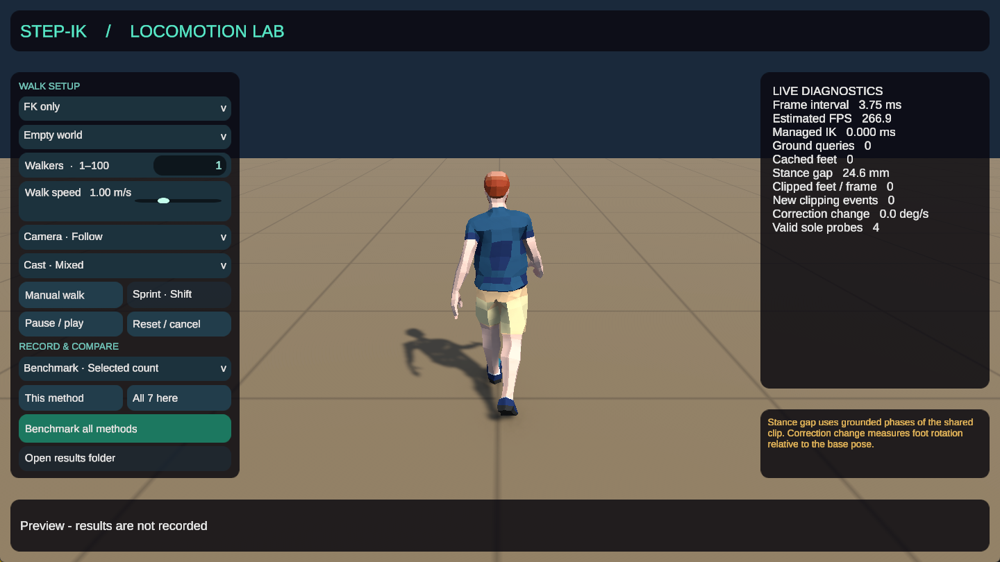
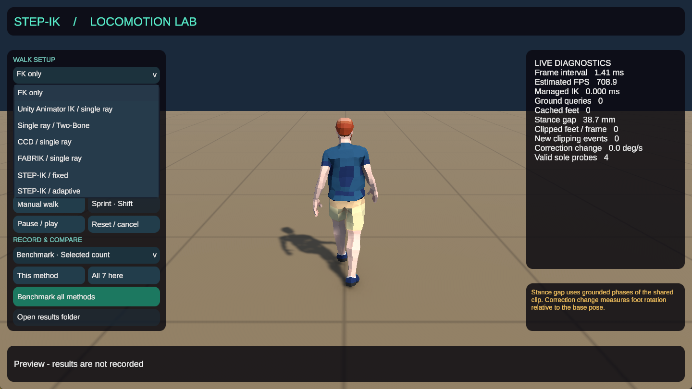

# STEP-IK Studio

STEP-IK (Surface Tracking for Enhanced Placement with Inverse Kinematics) is a Unity foot-placement component and a comparison sandbox. It keeps the authored walk animation and adjusts the legs to follow static terrain.

## Downloads

Download the file you need below, or see the [Release Notes](https://github.com/Mingyverse/STEP-IK/releases).

| File | Use |
| --- | --- |
| [STEP-IK-Studio-Windows-x64-v0.7.1.zip](https://github.com/Mingyverse/STEP-IK/releases/download/v0.7.1/STEP-IK-Studio-Windows-x64-v0.7.1.zip) | Play the standalone sandbox on Windows x64. Unity is unnecessary. |
| [STEP-IK-Unity-API-v0.7.1.unitypackage](https://github.com/Mingyverse/STEP-IK/releases/download/v0.7.1/STEP-IK-Unity-API-v0.7.1.unitypackage) | Import the C# component and humanoid setup menu into a Unity project. |

## Run the sandbox

1. Extract the entire Windows ZIP to a folder.
2. Open `STEP-IK Studio.exe` from that folder. Keep the executable, companion DLLs and data folder together.
3. Choose a world, method, camera and cast. Enter a walker count from **1 to 100**, then press Enter. The walk-speed slider spans **0.5–2.0 m/s**.
4. Drag in the 3D view to orbit. Enable **Manual Walk** to move one character with camera-relative **WASD** or arrow keys. Tap **Shift** or use the **Sprint** button while moving to sprint. Stopping resets sprint.

## Compare methods

The Studio selector and benchmark use the order shown below. Fixed and adaptive STEP-IK are separately selectable.

| Method | Contact sensing | Solver |
| --- | --- | --- |
| FK only | Base pose | Authored animation |
| Unity Animator IK / single ray | Sole midpoint | Unity Humanoid Animator IK |
| Single ray / Two-Bone | Sole midpoint | Analytical Two-Bone |
| CCD / single ray | Sole midpoint | Cyclic coordinate descent, 12 sweeps by default |
| FABRIK / single ray | Sole midpoint | FABRIK, 8 iterations by default |
| STEP-IK / fixed | Heel and toe, refreshed each frame | Analytical Two-Bone |
| STEP-IK / adaptive | Heel and toe, with cached contacts when valid | Analytical Two-Bone |

- **This method** records the current method and world. **All 7 here** records all methods in the current world.
- **Benchmark all methods** runs slopes, stairs and uneven ground. **Selected count** runs 21 trials. **50 + 100** runs 42 trials and takes about five minutes.
- Each trial uses a one-second warm-up and six seconds of capture. Conditions within a terrain and crowd size use the same cast, walk clip, speed and route.
- Stay in the Studio window during a timed run. Switching windows cancels the run to keep paused time out of the measurements. When you return, start a new run. Files from completed trials remain on disk.
- The results popup shows combined and terrain-level results. Use **Open results folder** to find the summary and per-trial CSV/JSON exports. On Windows the default parent folder is `%USERPROFILE%\AppData\LocalLow\DefaultCompany\STEP-IK Studio\StepIKBenchmarks`.

**Gap** measures absolute vertical distance between the sampled sole and ground during estimated stance. **Clip %** counts observed foot-frames with more than 10 mm of sampled penetration. Rotation change measures procedural correction motion. Managed IK time excludes Unity Animator IK's native solve. Frame time and process CPU/RAM include other work. Use the individual metrics alongside the weighted score and repeat runs before drawing performance conclusions.

## Add STEP-IK to a Unity character

1. In Unity, choose **Assets → Import Package → Custom Package** and import the API file. If the same scripts are already in the project at another path, resolve the duplicates before importing.
2. Set up a Humanoid Animator with exposed hips and leg bones and your existing animation controller. Use an upright neutral pose at uniform positive scale.
3. Select the character in the Hierarchy and choose **Tools → STEP-IK → Set Up Selected Humanoid**.
4. Assign a walkable collider layer to **Terrain Mask**. Check the heel and toe markers with Scene gizmos enabled and adjust the offsets for your model.
5. Disable competing foot IK on the same leg bones. Press Play and compare the base animation and STEP-IK on flat ground before trying stairs.

The component is `StepIKController`. Your locomotion code continues to drive the Animator and root. The API exposes `TryBindHumanoid`, `SetContactWeights`, `SetMode`, `StartSimulation`, `EndSimulation`, `ResetRuntime` and `Telemetry`. See the [humanoid setup and C# example](docs/HUMANOID_SETUP.md).

## Build from source

1. Clone into a short path such as `C:/Unity/STEP-IK` and add its root as a project in Unity Hub. The release was built with Unity **6000.5.6f1** and Windows Build Support. A short path helps Windows import long Unity package paths.
2. Import [City People FREE Samples](https://assetstore.unity.com/packages/3d/characters/city-people-free-samples-260446) by Denys Almaral through Unity Package Manager under **My Assets**. Keep its default folder layout. Source downloads contain project code and the scene generator. The Windows build contains the models embedded for playback.
3. Import TMP Essential Resources if prompted. Enable the Input System in **Project Settings → Player → Active Input Handling** and restart if Unity asks. For URP, ensure a URP asset is assigned in **Graphics** and in any applicable **Quality** override.
4. Select **Tools → STEP-IK → Build Comparison Sandbox**. Unity creates a scene in `Assets/StepIKGenerated`. Press Play to preview it, or add the generated scene to a Windows build profile and build. To use the release icon, assign `Assets/StepIKBranding/STEP-IK Icon.png` in the Player icon settings.
5. Use **Tools → STEP-IK → Run Math Checks** for solver, state and measurement checks.

## Scope and credits

This pre-1.0 release targets upright biped rigs and static colliders. New characters need sole calibration. Moving platforms, full-body balance, and navigation are outside the current component. The Windows sandbox includes licensed character art and clips from Denys Almaral's City People FREE Samples under the [Unity Asset Store EULA](https://unity.com/legal/as-terms). Third-party assets retain their respective terms.

